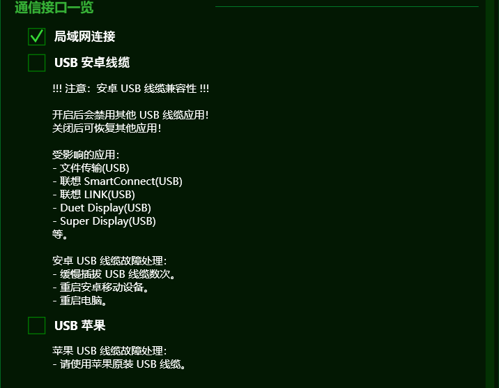
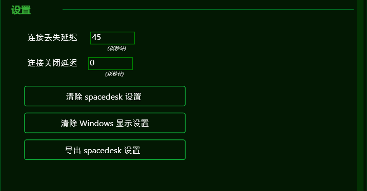
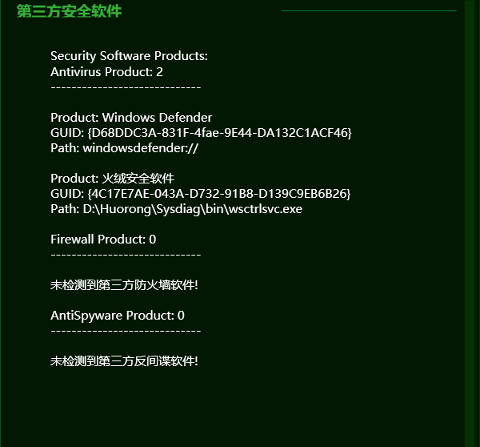
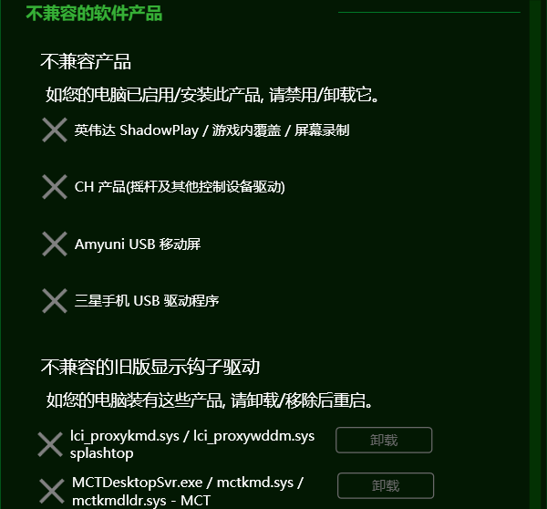
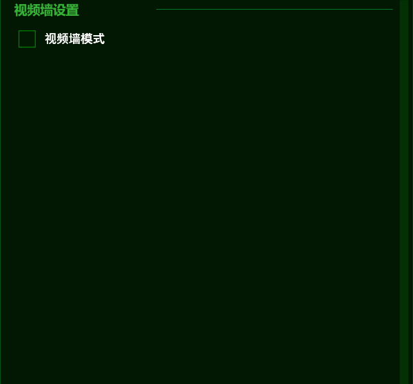

# spacedesk 中文版（Windows 控制台 + 安卓 APK）

把 spacedesk 的英文界面汉化成简体中文。仓库里放的是**改好的产物**和**可复现的工具/译文表**，不含官方原始安装包。

| 平台 | 产物 | 说明 |
|---|---|---|
| Windows | `windows/spacedeskConsole.exe`、`windows/spacedeskServiceTray.exe` | 直接替换安装目录下的同名文件（控制台 + 托盘） |
| Android | `android/spacedesk_zh_signed.apk` | 已签名可直接安装，包名与版本保持 `ph.spacedesk.beta` / 2.1.38 |

## 效果

Windows 控制台（截图仅保留右侧内容区）：







## 汉化范围

Windows 版：主窗口标题与横幅、左侧树全部节点、控制/设置区（含三个操作按钮与延迟项）、通信接口一览（局域网连接、USB 安卓线缆、USB 苹果 三组开关与其全部中长段说明）、系统信息、第三方安全软件、不兼容软件产品、视频墙、诊断面板、状态栏；托盘右键菜单、通知气泡标题、错误/警告提示。共替换 **362 处**（控制台 306、托盘 56）。

安卓版：原包自带 `values-zh-rCN` 但只有 109 条 AppCompat 库文案，应用自身 347 条全部缺中文。本次补译 **236 条**（zh-CN 从 109 → 345 条），另建 `arrays.xml` 覆盖 7 个设置选项数组：主界面与发现栏、连接状态、手动添加 IP、断开原因与错误码、首次启动提示、设置全部子页（分辨率校验、连接超时、加密、自动连接、触摸/手写笔、音频）、授权与 CAL 说明、SonarPen、各类 USB/网络 Toast。

## 仍然是英文的地方

- Windows：`ON`/`OFF` 单选标签（源串只有 2/3 字节，放不下汉字且左右对称）、`New` 按钮（3 字节）、"状态: OK" 的 `OK`、硬件与产品名（网卡型号、Windows Defender、火绒、Duet Display 等）、托盘连接气泡正文（服务端生成，本地资源无此串）。
- Android：库内部兜底文案（`m3_`/`mtrl_`/`fab_`/`appbar_` 等，正常不显示）、`pref_key_*`（是存储键，翻译会破坏设置读写）、应用名 `spacedesk`、网址、`<price>` 占位符、布局里硬编码的 `FPS: 0` 与 ` Ok `。

## 使用

Windows：把 `windows/` 下两个 exe 覆盖到 spacedesk 安装目录（默认 `C:\Program Files\spacedesk`），重启托盘程序即可。想恢复英文，双击 `windows/还原原版.bat`（它会从 `原版备份` 子目录拷回原始文件，所以请先把原始 exe 备份到该目录）。也可用 `SPACEDESK_DIR` 环境变量指定安装路径。

Android：`adb install -r android/spacedesk_zh_signed.apk`，或拷到手机点开安装。ColorOS 等系统对 adb 侧安装有账号校验，按屏幕提示验证即可。本包用调试证书签名，与商店版签名不同：若已安装商店版需先卸载。系统语言为简体中文时自动显示中文。

## 技术方案

**Windows：等长原地字节替换。** 界面文字只来自两处——`spacedeskConsole.exe` 的 `#US` 字符串堆与 12 个 `.baml` 资源流；`spacedeskServiceTray.exe` 的 `MENU`/`DIALOG`/`STRINGTABLE` 资源。译文编码后长度与原文完全一致（BAML 比 UTF-8 字节数，`#US`/Win32 资源比 UTF-16 编码单元数），不足用 U+200B 零宽空格与尾随空格补齐。偏移、长度字段、PE 与 BAML 结构一律不动，因此不必反编译重建，也不会错位。每次写入都带原字节校验，不匹配就拒绝。

**Android：补资源后重打包。** `apktool d` → 写入 `res/values-zh-rCN/`（`strings.xml` + `arrays.xml`）→ `apktool b`（aapt2）→ `zipalign -p -f 4` → `apksigner` 签名。

## 复现

```bash
# Windows（需要 pefile；原版 exe 放进安装目录的「原版备份」，或设 SPACEDESK_DIR）
python toolbox/windows/extract_baml.py     # 导出 .baml 供比对，输出 work/console_baml
python toolbox/windows/inventory.py        # 扫描全量可译串 → work/inventory.json
python toolbox/windows/gen_usb_help.py     # 生成 USB/Apple 长段等长译文 → data/zh_direct.json
python toolbox/windows/patch.py data/zh_table.json            # dry-run，逐条校验
python toolbox/windows/patch.py data/zh_table.json --apply    # 实际写入
python toolbox/windows/verify_native.py    # 回读校验托盘资源

# Android
apktool d spacedesk.apk -o android/decoded
python toolbox/android/fill_zh.py          # 幂等：已存在的键跳过
apktool b android/decoded -o zh_unsigned.apk
zipalign -p -f 4 zh_unsigned.apk zh_aligned.apk
apksigner sign --ks ~/.android/debug.keystore --ks-pass pass:android \
  --key-pass pass:android --ks-key-alias androiddebugkey --out spacedesk_zh_signed.apk zh_aligned.apk
```

打补丁前必须先退出 `spacedeskConsole.exe` 与 `spacedeskServiceTray.exe`，并确认目录里是原始文件，否则原字节校验不通过。

## 注意

- 打过补丁的 exe 的 Authenticode 签名失效，Windows 可能提示「未知发布者」，不影响功能。
- 升级 spacedesk 会覆盖这两个 exe，汉化随之失效。
- `spacedeskService.exe`（后台服务）不含界面文本，未做改动。
- 截图只保留了内容区：左侧导航栏会显示本机各网卡的真实 IP，右上角是计算机名，状态栏有授权到期日，这些都已裁掉。

## 声明

spacedesk 是 datronicsoft 的产品，本仓库只提供界面本地化补丁、译文与打包脚本，不提供官方安装包。请自行从官网或 Google Play 获取原版后套用。仅供个人学习与自用，请勿商业分发；若权利人提出要求，将立即移除相关内容。详见 [NOTICE.md](NOTICE.md)。
